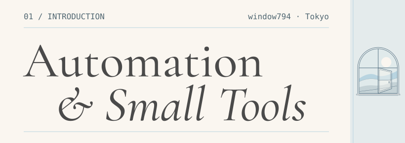
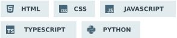
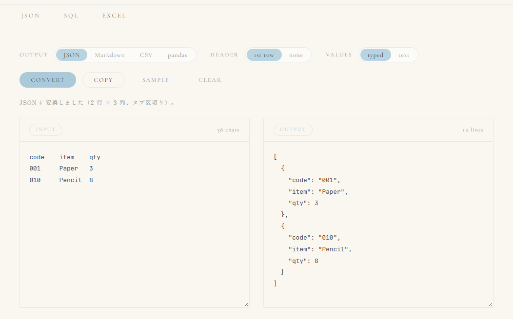
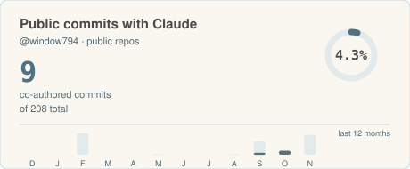

<h1>
  <picture>
    <source media="(prefers-color-scheme: dark)" srcset="./assets/masthead-dark.svg">
    
  </picture>
</h1>

I like making the small tools I wish I had beside me. Sometimes that means giving a spreadsheet one less manual step. Sometimes it means building a colour picker just to see how a shade of blue is put together.

## 02 / About me

I'm window794, an IT engineer based in Tokyo. I lived in England as a child and later studied political science at Seikei University. At work I build tools with Excel and Access. Outside work, I use the browser as a workshop and often talk an idea through with an AI partner before writing the first version.

## 03 / Experience & approach

**Business automation.** When an Excel task keeps coming back, I look at what has to happen before the workbook is ready to use. I've used Access SQL to extract the records a task needs, Access VBA to process them, and Excel VBA to build and maintain the tools people use for the next step. I've also used Power Automate for recurring workflows and revised the instructions that go with them.

**Personal development.** I tend to start with something small enough to try in a browser tab. Copying a query into a VBA module inspired a SQL-to-VBA converter. Curiosity about colour led to an RGB guessing game. Both give me a reason to care about the details of an interface.

**Working with AI.** A concrete example makes a good starting point for design and implementation. I can try a suggestion, look at the result and decide what to keep. One of those examples is the two-row spreadsheet below.

## 04 / Toolbox

**Used in Practice** · I build and maintain tools with Excel VBA and Access VBA. I use Access SQL to extract the business records a task needs and Power Automate for recurring workflows.

**Personal Projects** · I build browser tools with HTML, CSS and JavaScript. Other projects include a to-do app in TypeScript and a Google Apps Script version of Atelier Tools. TDC Food Chart uses Python to check shop links, and my VBA settings tool includes a PowerShell script that builds the workbook.

<picture>
  <source media="(prefers-color-scheme: dark)" srcset="./assets/languages-dark.svg">
  
</picture>

**Personal Environment & Tools** · I use Windows daily, both at work and at home. My home Linux machine runs Ubuntu, and I use it regularly. From my smartphone, I connect to it over a VPN with Termius as my remote client. On Ubuntu, I use tmux to manage terminal sessions. I've also used a Raspberry Pi in my own time.

**Familiar With / Exploring** · I've had some exposure to Oracle at work and have explored MySQL and SQL Server in personal projects. Other tools I've used include Anaconda, Tera Term, SI Object Browser and Obsidian.

## 05 / Selected works

### 01 — Atelier Tools

A quiet shelf of tools for moving data between formats. It formats JSON and SQL, converts a query into a VBA string and turns pasted Excel cells into Markdown, CSV or JSON. Plain JavaScript runs the conversion in the browser. In the example below, the code `001` keeps its zeros while the quantity becomes a number.

<picture>
  <source media="(prefers-color-scheme: dark)" srcset="./assets/atelier-dark.png">
  
</picture>

[Try Atelier Tools](https://window794.github.io/atelier-tools/) · [Repository](https://github.com/window794/atelier-tools)

### 02 — TDC Food Chart

An unofficial archive of 40 dishes from a Tokyo event. The star-chart interface lets you find a dish by shop, area or collectible coaster. One JSON file supplies the search and CSV export, and a service worker keeps the guide available offline.

[Explore the food chart](https://window794.github.io/tdc-food-chart/) · [Repository](https://github.com/window794/tdc-food-chart)

### 03 — Excel VBA Settings Obfuscator

A worksheet for keeping ordinary configuration values out of plain sight. Excel VBA converts UTF-8 text to Base64, applies a reversible substitution and stores the table ID with the result. It is designed for non-sensitive settings. The repository includes the VBA modules and a PowerShell workbook builder.

[Workbook and source](https://github.com/window794/excel-vba-settings-obfuscator)

### 04 — HEX / RGB

A browser tool for understanding a colour one channel at a time. Move a slider and JavaScript keeps the hex digits, colour picker and three-axis RGB map in sync. Once the correspondence starts to feel intuitive, there's a colour-guessing game.

[Try the colour lab](https://window794.github.io/hex-rgb/) · [Repository](https://github.com/window794/hex-rgb)

### 05 — Oyabun Darts

A joke about data-breach headlines became a darts game in which a fictional crime boss picks a fictional company. A single HTML page with JavaScript handles a 20-segment board, count-up scoring and a 501 mode that suggests a possible one-dart finish.

[Play Oyabun Darts](https://window794.github.io/oyabun-darts/) · [Repository](https://github.com/window794/oyabun-darts)

## 06 / GitHub contributions

One column for each day on my GitHub calendar. Height follows the day's activity.

<picture>
  <source media="(prefers-color-scheme: dark)" srcset="https://raw.githubusercontent.com/window794/window794/refs/heads/profile/design-system/assets/calendar-dark.svg">
  
</picture>

[Browse my activity on GitHub](https://github.com/window794?tab=overview)

## 07 / Building with AI

Should `001` survive a spreadsheet conversion? It's a useful question to bring to ChatGPT or Claude when working out what a tool should do. With Codex or Claude Code, I can take an example through implementation, run it against the result I expect, and review the change before keeping it.

On 22 November 2026, 9 of my 208 indexed public commits credited Claude in a `Co-authored-by:` trailer. The card counts those recorded credits. Conversations and reviews can also shape a tool without appearing in its Git history.

<picture>
  <source media="(prefers-color-scheme: dark)" srcset="./assets/coauthors-dark.svg">
  
</picture>

[Read a co-authored change to Oyabun Darts](https://github.com/window794/oyabun-darts/commit/c03b990e84945992b703fed0ce4aa12aad2da306)

## 08 / Closing

Thanks for browsing my little tool shelf. I hope you find something that saves you a few steps.
