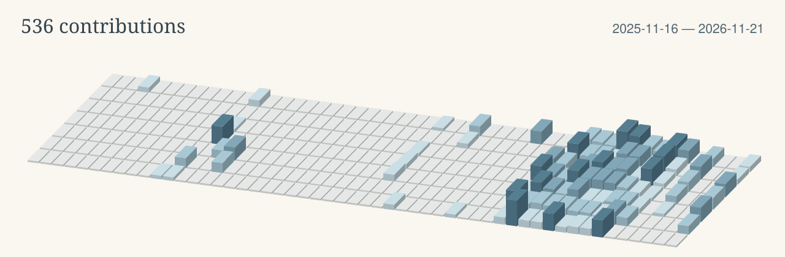
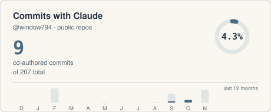

<picture>
  <source media="(prefers-color-scheme: dark)" srcset="./assets/cover-dark.svg">
  
</picture>

# Hello, I'm window794.

I'm an IT engineer in Tokyo. At work, I test systems and build tools for the repetitive parts of the job. In my own projects, the starting point can be as small as a SQL query that's awkward to paste into VBA, or a colour I'd like to understand by taking it apart.

## 01 · About & experience

I spent part of my childhood in England, from 1995 to 1997, and have lived in Tokyo since returning to Japan. I studied political science at Seikei University before working in IT. Much of my work happens between a system and the person who has to run the same procedure tomorrow.

**Testing & quality assurance.** On end-to-end tests for mobile telecommunications systems, I helped prepare scenarios, ran the tests and extracted data to check the results. I wrote and revised the instructions for running those tests, and built Excel VBA tools to support the work.

**Business automation.** I've built and maintained tools in Excel VBA and Access VBA, written Access SQL queries to pull the records a task needs, and used Power Automate for recurring steps. Sometimes the most useful change is simply giving someone a way to finish an Excel routine in fewer steps.

## 02 · Toolbox

### Used in practice

Excel VBA and Access VBA for tools I maintain, Access SQL for extracting business data, and Power Automate for recurring workflows.

### Personal development / exploring

I use HTML, CSS and JavaScript for browser tools. I also explore TypeScript, Python, Google Apps Script, MySQL and SQL Server in personal projects.

### Other tools & environments

I've had some hands-on exposure to Oracle at work. I use Linux and Ubuntu in personal projects. Other tools I've used include Anaconda, Tera Term, SI Object Browser and Obsidian.

### AI-assisted development

ChatGPT, Claude, Codex and Claude Code are part of my personal development process, from sketching a requirement to reviewing a change.

## 03 · Selected projects

### [Atelier Tools](https://github.com/window794/atelier-tools)

A small shelf of browser tools for the moments when data is almost in the right format. One tab turns a SQL query into a VBA string and back. Another converts pasted Excel cells to JSON, Markdown, CSV or pandas while preserving leading zeros in values like `001`. The input stays in the browser.

### [TDC Food Chart](https://github.com/window794/tdc-food-chart)

An unofficial star-chart guide to 40 dishes from a Tokyo event, now preserved as an archive. Visitors can look up a dish by shop, area or collectible coaster. One JSON file powers search and CSV export, and a service worker makes the guide available offline.

### [Excel VBA Settings Obfuscator](https://github.com/window794/excel-vba-settings-obfuscator)

A workbook for keeping ordinary settings out of plain sight. VBA encodes UTF-8 text as Base64, applies a reversible substitution table and stores its ID alongside the result. Self-tests cover Japanese text, symbols and line breaks. The scheme is intended for non-sensitive values.

### [HEX / RGB](https://github.com/window794/hex-rgb)

A colour converter that lets you see what each pair of hex digits does. Move a slider and the hex value, colour picker and three-axis RGB map change together. A guessing game turns the same relationship into something you can practise.

### [Oyabun Darts](https://github.com/window794/oyabun-darts)

A run of data-breach headlines inspired a joke about a fictional crime boss choosing the next company by throwing a dart. Underneath the joke is a playable 20-segment board with count-up scoring and a 501 mode that suggests a finish when one dart will do.

## 04 · Contributions

Each column represents one day on my GitHub contribution calendar. Taller columns mark busier days.

<picture>
  <source media="(prefers-color-scheme: dark)" srcset="./assets/calendar-dark.svg">
  
</picture>

[Explore the activity behind the calendar on GitHub](https://github.com/window794?tab=overview).

## 05 · Building with AI

I often start by talking through a requirement with ChatGPT or Claude. For a spreadsheet converter, an example like `001` makes the design question concrete. Is this a number, or an identifier whose zeros matter? Once the expected result is clear, I can work with Codex or Claude Code on the implementation, try the input myself, and review the diff against that decision.

On 22 November 2026, 9 of my 207 indexed public commits credited Claude in a `Co-authored-by:` trailer. A design conversation or a review can shape a project without leaving that entry in Git.

<picture>
  <source media="(prefers-color-scheme: dark)" srcset="./assets/claude-dark.svg">
  
</picture>

[Read a co-authored change to Oyabun Darts](https://github.com/window794/oyabun-darts/commit/c03b990e84945992b703fed0ce4aa12aad2da306).

---

*Thanks for stopping by. I hope there's something on the tool shelf you can use.*
